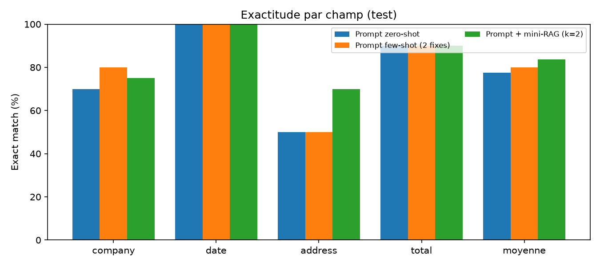
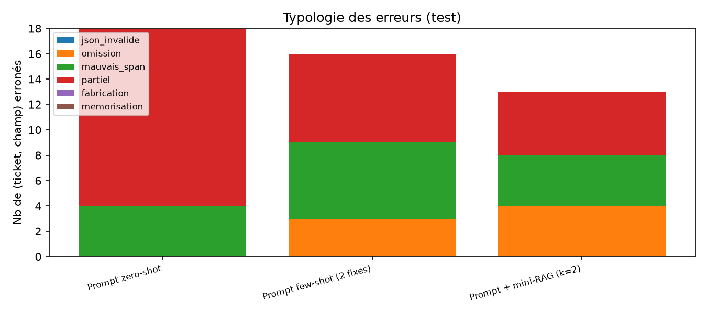

# Résultats — split `test`

Tailles : {'train': 551, 'val': 75, 'test': 345} — enseignes du test vues au train : 225, jamais vues : 120. Doublons exacts retirés du test : 2.

Vérité terrain lisible dans l'OCR (plafond atteignable sans mémorisation) : company 98.3 %, date 98.8 %, address 98.3 %, total 100.0 %

## Tableau principal (exact match %, F1 tokens %)

| Condition | company | date | address | total | **EM moyen** | F1 moyen | ticket 100 % juste | JSON valide | valeurs non ancrées | EM enseigne vue | EM enseigne jamais vue | s/ticket |
|---|---|---|---|---|---|---|---|---|---|---|---|---|
| Prompt zero-shot | 70.0 | 100.0 | 50.0 | 90.0 | **77.5** | 91.5 | 25.0 | 100.0 | 0.0 | 80.0 | 75.0 | 1.529 |
| Prompt few-shot (2 fixes) | 80.0 | 100.0 | 50.0 | 90.0 | **80.0** | 87.1 | 35.0 | 100.0 | 0.0 | 75.0 | 85.0 | 1.279 |
| Prompt + mini-RAG (k=2) | 75.0 | 100.0 | 70.0 | 90.0 | **83.8** | 87.5 | 55.0 | 100.0 | 1.3 | 87.5 | 80.0 | 1.868 |

## Le fine-tuning bat-il la baseline prompt ? (tests appariés)

Bootstrap apparié (2000 tirages, par ticket) sur l'EM moyen par ticket, et McNemar exact par champ. Différence = B − A en points.

| A | B | Δ EM (pts) | IC 95 % | McNemar p (company) | McNemar p (date) | McNemar p (address) | McNemar p (total) |
|---|---|---|---|---|---|---|---|
| Prompt zero-shot | Prompt few-shot (2 fixes) | +2.5 | [-2.5 ; +8.8] | 0.5 | 1 | 1 | 1 |
| Prompt few-shot (2 fixes) | Prompt + mini-RAG (k=2) | +3.8 | [-3.8 ; +11.2] | 1 | 1 | 0.219 | 1 |

## Typologie des erreurs et hallucinations (nombre de couples ticket×champ)

| Condition | correct | json_invalide | omission | mauvais_span | partiel | fabrication | memorisation |
|---|---|---|---|---|---|---|---|
| Prompt zero-shot | 62 | 0 | 0 | 4 | 14 | 0 | 0 |
| Prompt few-shot (2 fixes) | 64 | 0 | 3 | 6 | 7 | 0 | 0 |
| Prompt + mini-RAG (k=2) | 67 | 0 | 4 | 4 | 5 | 0 | 0 |

- **fabrication** : valeur absente du ticket et sans lien avec la vérité (hallucination au sens strict).
- **memorisation** : valeur absente du ticket mais identique à une cible du train (le modèle « récite »).
- **mauvais_span** : valeur réellement présente mais mal choisie (ex. sous-total au lieu du total).

## Exemples d'hallucinations (fabrication / mémorisation)

